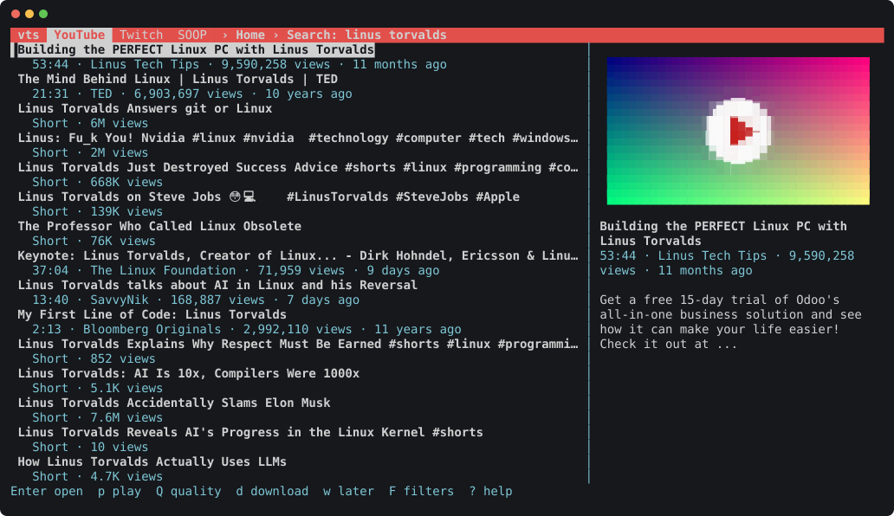
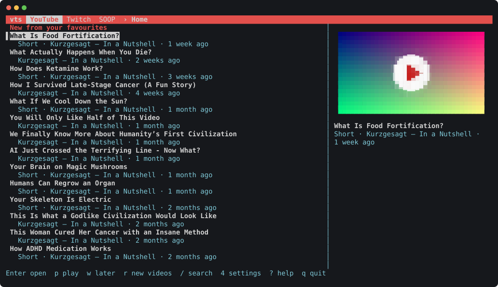
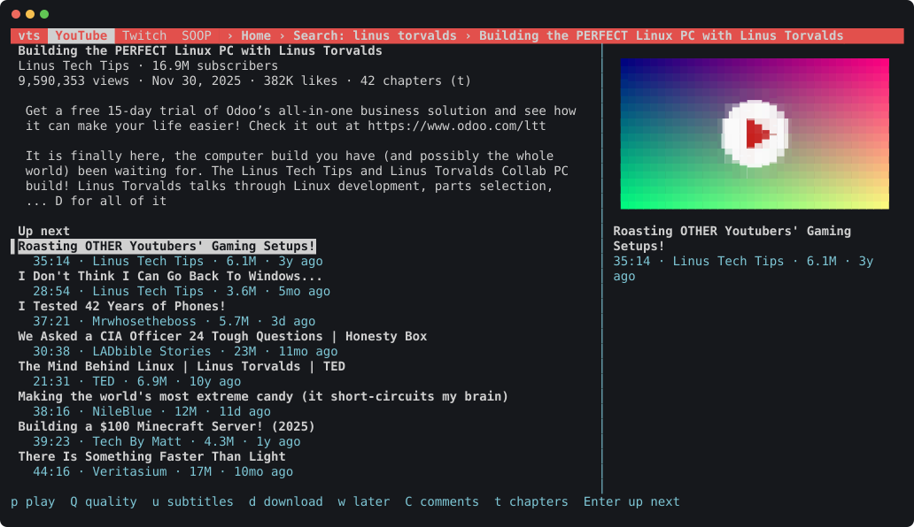
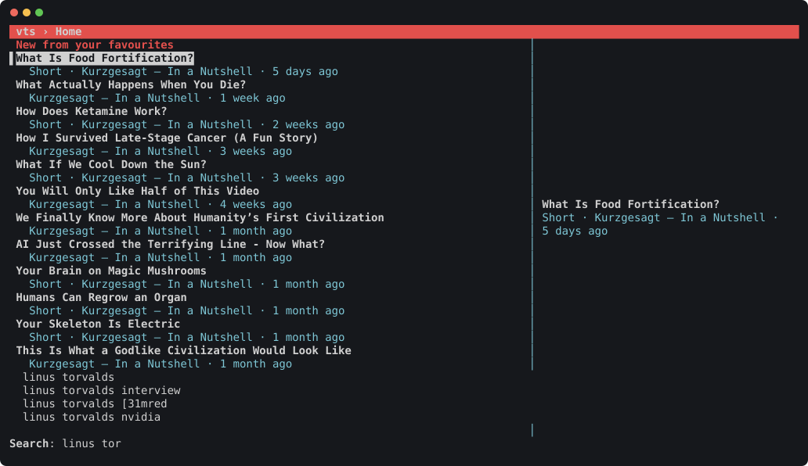
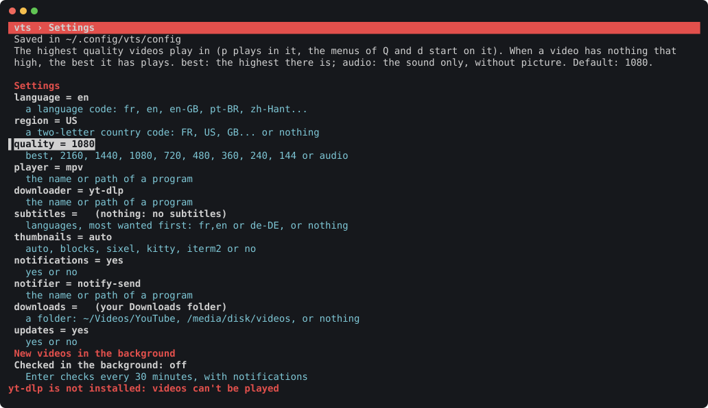

# VTS, the Video Terminal Shell

A terminal client for YouTube: search, watch, browse channels, playlists
and comments, keep a list of favourite channels and get notified of their
new videos, all without a Google account. For Linux and Windows.



Run `vts` for the full screen app, or give it a command for scripts and
quick looks. Videos play in [mpv](https://mpv.io) while you keep
browsing.

- **Search like on the website.** Videos, Shorts, channels, playlists and
  live streams (a red LIVE before their title, SOON for those to come),
  the same filters (upload date, duration, type, features, sort order)
  and suggestions while you type.
- **The video page.** Description, chapters, comments and replies, and
  the videos up next.
- **Channels and playlists.** Their Videos, Shorts, Live and Playlists
  tabs, and search inside a channel.
- **Watch in mpv.** Quality, subtitles, speed, sound only (in high,
  medium or low quality), a queue that
  plays on, live streams, the video inside the terminal, and every video
  resumes where you stopped.
- **Favourite channels, no account.** Your own list, the subscriptions
  you export from Google Takeout (or an OPML file), exported back when
  you want, and a desktop notification for each new video, even with vts
  closed.
- **Twitch's live streams too.** `b` goes to Twitch (in purple): your
  favourite channels, those live first, played in mpv without Twitch's
  ads (through Streamlink, which comes with vts), in the quality you
  choose, and recorded to a file if you want. No account either.
- **Your library, on your computer.** History, Watch later and your own
  playlists, never sent anywhere.
- **Thumbnails in the terminal,** as pictures where the terminal can show
  them (kitty, Ghostty, WezTerm, foot, Konsole, iTerm2, Windows
  Terminal), in coloured blocks elsewhere.
- **Settings explained, changed in the app.** Every setting says what it
  does and which values it takes, and changes on the Settings screen
  (`4`), with "Check now" and "Update now" there too: no file to edit by
  hand. `vts config --help` explains them on the command line.
- **It keeps up with YouTube.** When YouTube changes its pages, vts picks
  up the fix by itself within a day, and keeps yt-dlp up to date.

Some things need a Google account and stay out of reach: liking,
commenting, subscribing on YouTube's side, YouTube's own recommendations,
age-restricted and members-only videos.

## Using it

| | |
| --- | --- |
|  |  |
|  |  |

In the app, `?` shows the keys. The main ones:

| Key                 | What                                              |
| ------------------- | ------------------------------------------------- |
| `1` `2` `3` `4`     | Home, Favourites, Library, Settings               |
| `b`                 | the next site: YouTube, Twitch, SOOP (SOOP is on its way) |
| `/`                 | search (recent searches, suggestions as you type, `F` for filters; Esc cancels); a link or an @handle opens what it names, a handle without its @ is found too |
| Enter, Backspace    | open, back                                        |
| `p` `P` `a`         | play, play from here on, sound only               |
| `Q`                 | play in a quality you choose (144p to 4K, or the sound only: high, medium or low) |
| `u`                 | choose the subtitles (also while it plays)        |
| `d`                 | download the video in a quality, or the sound (high, medium or low quality); on a Twitch or SOOP live stream, record it until you stop it |
| `w` `+` `A`         | Watch later, add to a playlist, add to what plays |
| `c` `f` `y`         | the channel, favourite it, copy the link          |
| `C` `t` `D`         | on a video: comments, chapters, whole description |
| Space `<` `>` `x`   | while playing: pause, previous, next, stop        |
| `,` `.` `9` `0` `m` | while playing: back, forward 10 s, volume, mute   |
| `T` `V`             | while playing: a chapter, go on in another quality |
| `-`                 | remove from a list, the history, the favourites   |
| `N` `i` `e`         | on Favourites: add a channel (@handle or link), import, export |
| `q`                 | back, and quit from a section                     |

The mouse works too: click to select, double-click to open, the wheel to
scroll.

Everything in the app also has a command:

```console
$ vts search -t video -d week -s views linux kernel
$ vts search -f live,4k lofi radio
$ vts search --json --pages 3 linus torvalds
$ vts info https://youtu.be/dQw4w9WgXcQ
$ vts comments --newest --replies dQw4w9WgXcQ
$ vts channel -t shorts @kurzgesagt
$ vts channel --search "black hole" @kurzgesagt
$ vts playlist PLFs4vir_WsTxontcYm5ctqp89cNBJKNrs
$ vts fav add -g Science @kurzgesagt
$ vts fav import subscriptions.csv   # from Google Takeout
$ vts play dQw4w9WgXcQ                # resumes where you stopped
$ vts play -a -s 1.5 PLFs4vir_WsTxontcYm5ctqp89cNBJKNrs
$ vts download -q 720 -d ~/Videos dQw4w9WgXcQ
$ vts download --audio-format mp3 -d ~/Music dQw4w9WgXcQ
$ vts download --audio-format mp3 --sound-quality medium dQw4w9WgXcQ
$ vts subtitles dQw4w9WgXcQ           # then: vts play --subs de-DE ...
$ vts check --install                 # new videos notified every 30 minutes
$ vts doctor                          # does everything work?
```

New videos come from each favourite's public feed: no account, no API
key. Favourites, history, Watch later and your playlists stay in
`~/.local/share/vts/vts.db` (on Windows, `%LOCALAPPDATA%\vts`). Results
come in the language and country of your system, or those set in the
settings (`vts config --help` lists them).

[The guide](doc/GUIDE.md) goes through all of it, [the manual
page](doc/vts.1) is the reference (`man -l doc/vts.1`), and `vts doctor`
says what to fix when something doesn't work:

```console
$ vts doctor
vts 1.0.0
  ok  settings     /home/me/.config/vts/config
  ok  library      /home/me/.local/share/vts/vts.db: 12 favourite channels, 3 playlists
  ok  player       mpv v0.38.0
  ok  yt-dlp       2026.11.10
  ok  deno         deno 2.5.6
  ok  ffmpeg       /usr/bin/ffmpeg
  ok  notifier     /usr/bin/notify-send
  ok  timer        new videos checked by /home/me/.config/systemd/user/vts-check.timer
  ok  rules        revision 2026111302, built in; updates on, checked 3 h ago
  ok  search       20 results, web client 2.20261111.01.00
  ok  video page   20 videos up next, comments
  ok  feeds        15 videos from Kurzgesagt – In a Nutshell
  ok  suggestions  10
  ok  thumbnails   kitty, for this terminal
Everything works.
```

## Keeping up with YouTube

YouTube changes its pages often. Where vts finds each piece of
information is described in a data file, and once a day the app (or
`vts check`) fetches the latest one from this repository, checks it, and
keeps it only if it is complete and newer. Once a week it has yt-dlp
update itself, when you installed yt-dlp yourself rather than through
your system's packages. `vts update` (or "Update now" in the app's
Settings) does both now; `updates = no` in the settings or `--offline`
turns it off.

## Install

### Windows 10 or 11

One line in PowerShell installs everything vts needs (mpv, yt-dlp,
deno, ffmpeg, Python), then vts itself, and checks it all with `vts
doctor`:

```powershell
irm https://raw.githubusercontent.com/ifupauline/vts/main/install.ps1 | iex
```

Then open a new window and type `vts`. The same line updates vts
later. Windows Terminal is best: opened from one of its tabs, vts shows
the thumbnails as pictures (in a window started otherwise, as coloured
blocks, or as pictures with `thumbnails` set to `sixel` in the app's
Settings).

### Linux

vts is a Python program (3.10 or later), installed with
[pipx](https://pipx.pypa.io). It uses [mpv](https://mpv.io) to play,
[yt-dlp](https://github.com/yt-dlp/yt-dlp) to get the videos (its own
release: distribution packages are often too old for YouTube, and vts
keeps this one up to date), [deno](https://deno.com), which yt-dlp needs
for YouTube, [ffmpeg](https://ffmpeg.org) for the best qualities and
MP3s, and `notify-send` for notifications. On Debian or Ubuntu:

```sh
sudo apt install pipx mpv ffmpeg libnotify-bin
curl -fsSL https://deno.land/install.sh | sh
curl -L https://github.com/yt-dlp/yt-dlp/releases/latest/download/yt-dlp -o ~/.local/bin/yt-dlp
chmod +x ~/.local/bin/yt-dlp
pipx install git+https://github.com/ifupauline/vts
```

Then type `vts`. `pipx reinstall vts` gets a newer vts.

### Then

`vts doctor` says whether everything is there and what to fix.
[Uninstall](#uninstall) says how to remove it all.

[doc/DEVELOPERS.md](doc/DEVELOPERS.md) has the rest, and
[SECURITY.md](SECURITY.md) how vts handles what comes from the network.

## Where vts keeps its files

vts keeps everything in your own folders, readable by you only, and
sends nothing anywhere: no account, no telemetry.

### Windows

| What | Where |
| --- | --- |
| Settings (a text file) | `%APPDATA%\vts\config` |
| Library: favourites, history, Watch later, playlists, recent searches, the list of downloads (SQLite) | `%LOCALAPPDATA%\vts\vts.db` (with `vts.db-wal` and `vts.db-shm`) |
| The site you were on, for `start_site = last` | `%LOCALAPPDATA%\vts\last-site` |
| Cache, safe to delete: thumbnails (`thumbs`), the latest rules (`rules.json`), YouTube's web client version (`client`), when updates last ran (`checked-*`), yt-dlp's version (`yt-dlp-version`), the app's log (`vts.log`), mpv's (`mpv.log`) and Streamlink's (`streamlink.log`) | `%LOCALAPPDATA%\vts\cache` |
| Downloads and recordings of live streams | your Downloads folder, or the `downloads` setting |
| The program | `%USERPROFILE%\.local\bin\vts.exe`, and its Python environment in pipx's folder (`py -m pipx environment` says where), Streamlink (for Twitch's and SOOP's live streams) inside it |
| Check of new videos, only after `vts check --install` | a task named `vts-check` in Task Scheduler |

The install script also adds `%USERPROFILE%\.local\bin` to your PATH
(so that `vts` works in any window), and installs with winget the
programs that are missing: mpv (in `C:\Program Files\MPV Player`),
yt-dlp, deno and ffmpeg (in winget's own folders), Python and pipx.
Nothing else: no service, nothing at startup.

### Linux

| What | Where |
| --- | --- |
| Settings (a text file) | `~/.config/vts/config` |
| Library (SQLite) | `~/.local/share/vts/vts.db` (with `vts.db-wal` and `vts.db-shm`) |
| The site you were on, for `start_site = last` | `~/.local/share/vts/last-site` |
| Cache, safe to delete (the same files as on Windows) | `~/.cache/vts` |
| mpv's connection while a video plays, removed after | `$XDG_RUNTIME_DIR/vts` |
| Downloads and recordings of live streams | `~/Downloads`, or the `downloads` setting |
| The program | `~/.local/bin/vts`, and its Python environment in pipx's folder (`pipx environment` says where), Streamlink inside it |
| Check of new videos, only after `vts check --install` | `~/.config/systemd/user/vts-check.service` and `vts-check.timer` |

The `XDG_CONFIG_HOME`, `XDG_DATA_HOME`, `XDG_CACHE_HOME` and
`XDG_DOWNLOAD_DIR` variables move them, and `vts -c FILE` reads the
settings from another file. `vts doctor` shows where the settings and
the library are.

## Uninstall

### Windows

In PowerShell, remove vts (the first line stops the check of new videos
in the background, if you turned it on):

```powershell
vts check --uninstall
py -m pipx uninstall vts
```

To delete your settings, favourites, history and playlists too (your
downloaded videos stay where they are):

```powershell
Remove-Item -Recurse -Force "$env:APPDATA\vts", "$env:LOCALAPPDATA\vts"
```

The install also added these programs; remove those you don't use for
anything else:

```powershell
winget uninstall shinchiro.mpv
winget uninstall yt-dlp.yt-dlp
winget uninstall yt-dlp.FFmpeg
winget uninstall DenoLand.Deno
py -m pip uninstall pipx
```

(ffmpeg is `Gyan.FFmpeg` if the install put that one; Python goes from
Settings, Apps, if you want.)

### Linux

```sh
vts check --uninstall
pipx uninstall vts
rm -r ~/.config/vts ~/.local/share/vts ~/.cache/vts   # your data, if you want
```

## License

Apache License 2.0, see [LICENSE](LICENSE) and [NOTICE](NOTICE).

YouTube is a trademark of Google LLC. vts is an independent project, not
affiliated with or endorsed by Google or YouTube.
