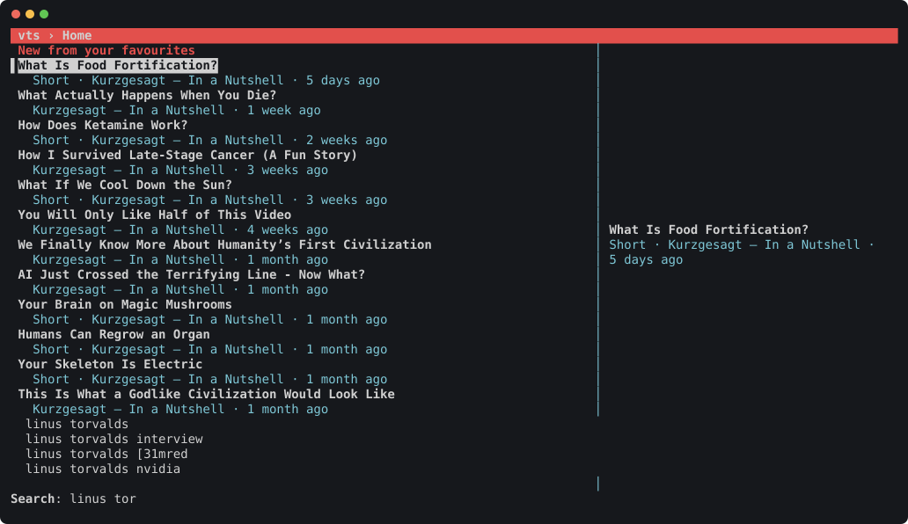

# Using vts

vts is YouTube in a terminal, without a Google account: search, watch,
browse channels, playlists and comments, keep favourite channels and be
told about their new videos. This guide goes through it in the order
you are likely to need it. [The manual page](vts.1) has the reference
(`man -l doc/vts.1`). It works the same on Linux and on Windows; where
they differ, it is said.

## Before you start

vts plays videos with [mpv](https://mpv.io) and gets them through
[yt-dlp](https://github.com/yt-dlp/yt-dlp), which needs
[deno](https://deno.com) to read YouTube's player and
[ffmpeg](https://ffmpeg.org) for the best qualities; on Linux,
notifications go through `notify-send`. [The README](../README.md#install)
says how to install them and vts, on Linux and on Windows. On Windows,
one line in PowerShell does all of it:

```powershell
irm https://raw.githubusercontent.com/ifupauline/vts/main/install.ps1 | iex
```

For yt-dlp, prefer its own release over the distribution's package,
which is often too old for YouTube: download the `yt-dlp` program from
its releases page into `~/.local/bin` and make it executable. vts then
keeps it up to date (see [Keeping up with YouTube](#keeping-up-with-youtube)).

The app says what is missing when it starts. To check everything:

```console
$ vts doctor
```

Each line says `ok`, `--` (not set up, which is fine), `!!` (works, but
look at it) or `XX` (doesn't work), and what to do about it.

## The app

Run `vts` alone. The screen has a top bar (where you are, and what is
playing), the list, and a line of keys at the bottom. `?` shows all the
keys; `q` goes back, and quits from one of the four sections:

- `1` **Home**: the videos you were watching and stopped in the middle
  of, then the latest videos of your favourite channels. `r` looks for
  new ones.
- `2` **Favourites**: your channels. `N` adds one by its @handle or link,
  `n` turns its notifications on or off, `S` whether its Shorts count,
  `g` puts it in a group, `i` imports a subscriptions file and `e`
  exports them (OPML, or CSV when the name ends in `.csv`).
- `3` **Library**: Watch later, your own playlists, your downloads and
  the history.
- `4` **Settings**: each setting with what it does and the values it
  takes, in sections (General, then YouTube's, Twitch's and SOOP's); Enter changes the selected one (from a menu, or typed), `d`
  puts it back to its default, and it is saved in the settings file at
  once. At the bottom, the checks in the background (on or off),
  "Check now", which tries everything as `vts doctor` does, and "Update
  now", which does what `vts update` does. Nothing needs a file edited
  by hand.

`/` searches, from anywhere: your recent searches come first (Delete
forgets one), then as you type, suggestions come as on the website
(Tab or the arrows pick one); Enter searches, Esc (or Backspace when
nothing is typed) cancels. A link (of a video, a channel or a
playlist) or a channel's @handle opens what it names instead of
searching for its words; and when YouTube finds nothing for a word, vts
tries it as a channel's handle (`maetube0130`). The results open over where you were,
so Backspace goes back there. On the results, `F` sets the filters:
type, upload date, duration, sort order and features (live, 4K,
subtitles...). In every list, a live stream has a white on red LIVE
before its title, and one still to come a SOON.



Move with the arrows or `j`/`k` (`g`/`G` for the top and bottom), open
with Enter, go back with Backspace. Lists load more as you reach their
end. The mouse works too. What you watched is marked in every list:
"watched", or where you stopped.

On any video in a list:

| Key | |
| --- | --- |
| `p` | play it |
| `P` | play it and everything after it in the list |
| `a` | play the sound only (in the quality of the `sound_quality` setting) |
| `Q` | play it in a quality you choose: best, 4K (2160p) down to 144p, or the sound only, then high, medium or low |
| `u` | play it with the subtitles you choose, from those it has |
| `w` | add to Watch later |
| `A` | add to what plays, after the rest |
| `+` | add to one of your playlists (or a new one) |
| `d` | download it: the video in a quality you choose, or the sound only (as YouTube has it, or as MP3, M4A, Opus or FLAC), then high, medium or low |
| `c` | go to its channel |
| `f` | make its channel a favourite |
| `y` | copy its link (in terminals that allow it) |

A **video page** shows the description (`D` for all of it), the number
of chapters (`t` to pick one and play from there), comments (`C`; `o`
switches between top and newest, Enter opens the replies) and the
videos up next.

A **channel** has its tabs (Videos, Shorts, Live, Playlists: Tab or
`[`/`]` to switch) and `/` searches inside it.

While a video plays, mpv has its own window and you keep browsing: the
top bar shows the position. Space pauses, `,` and `.` go back and
forward 10 seconds, `9` and `0` turn the volume down and up, `m` mutes,
`<` and `>` go to the previous and next video of the queue, `T` goes to
one of its chapters, `x` stops, and `V` goes on in another quality from
where it is (a live stream from now). The quality of the
settings (`quality`, 1080p unless you change it) is the one `p` uses and
the one the menus start on; when a video has nothing that high, the
best it has plays.

Subtitles: `u` lists those the video has, written for it or made by
YouTube (in the language spoken, and translated into yours), and while
a video plays, `u` changes them (or turns them off) and it goes on from
where it was. `subtitles = fr,en` in the settings picks them by
default.

Downloads go into your Downloads folder (or the one set with
`downloads = ~/Videos/YouTube` in the settings) and go on in the
background:
the top bar shows how far the first one is (with how many more), and a
message says when it is done, or why it failed. Quitting while one goes
on asks first, since it would stop it. **Downloads**, in the Library,
lists those under way (`-` stops one) and those done: Enter plays the
file, `o` says where it is, `-` takes it off the list (the file stays).
MP3, M4A, Opus and FLAC need ffmpeg (`sudo apt install ffmpeg`), as
does joining the picture and the sound of the higher qualities. Where you stop goes into the
history and the next time starts there.

### Thumbnails

In a terminal 100 columns wide or more, the selected result is shown on
the right with its thumbnail. kitty, Ghostty, WezTerm, foot, Konsole,
iTerm2 and Windows Terminal show real pictures; other terminals get
coloured blocks (finer ones when [chafa](https://hpjansson.org/chafa/)
is installed). If the
pictures don't show right (inside tmux, for example), set the kind in
the settings: `thumbnails = blocks`, or `no` for none.

## Favourite channels and new videos

Make a channel a favourite with `f` in the app (or `N` on the
Favourites screen, with its @handle or link), or:

```console
$ vts fav add @kurzgesagt
$ vts fav add -g Science https://www.youtube.com/@veritasium
```

Bring your YouTube subscriptions: in [Google Takeout](https://takeout.google.com)
export "YouTube and YouTube Music", subscriptions only, then

```console
$ vts fav import subscriptions.csv
```

(or `i` on the Favourites screen). OPML files from feed readers work too,
and `vts fav export` (or `e` on the Favourites screen) writes one.

For each favourite you can choose whether its new videos are notified
and whether its Shorts count: `n` and `S` on the Favourites screen, or
`vts fav set @kurzgesagt notify=no shorts=no`. `g` puts it in a group.

New videos come from each channel's public feed, the same one feed
readers use: no account, no key. To be told about them while vts isn't
open:

```console
$ vts check --install
```

checks every 30 minutes (`vts check --install 15` for every 15) with a
systemd timer of your user (on Windows, a scheduled task), and sends a
desktop notification for each new video, with two buttons where the
desktop has them: **Play** and **Watch later**. The first check of a
new favourite only notes what is already there. `vts check --uninstall`
stops it; Settings (`4`) turns it on and off too.

## Your library

Everything stays on your computer, in `~/.local/share/vts/vts.db` (on
Windows, `%LOCALAPPDATA%\vts\vts.db`): nothing is sent anywhere. Watch later and your playlists are in the
Library (`3`): `N` makes a new playlist, `R` renames it, `-` deletes it.
In a playlist or the history, `-` (or Delete) removes the selected video
and `X` clears the history.

From the command line: `vts later`, `vts list`, `vts history`.

## From the command line

Every screen of the app has a command that prints the same thing, for
scripts and quick looks:

```console
$ vts search -t video -d week -s views linux kernel
$ vts info dQw4w9WgXcQ
$ vts comments --newest dQw4w9WgXcQ
$ vts channel -t playlists @kurzgesagt
$ vts play -q 720 --subs fr,en dQw4w9WgXcQ
$ vts download -a -d ~/Music PLFs4vir_WsTxontcYm5ctqp89cNBJKNrs
$ vts download --audio-format mp3 dQw4w9WgXcQ
$ vts download --audio-format mp3 --sound-quality low dQw4w9WgXcQ
$ vts play --sound-quality medium dQw4w9WgXcQ
$ vts subtitles dQw4w9WgXcQ
$ vts play --subs de-DE dQw4w9WgXcQ
```

On a terminal each result takes two lines; piped into another program,
it is one line of tab-separated fields; `--json` gives JSON.

## Settings

In the app, Settings (`4`) shows them, explained, and changes them. On
the command line, `vts config` shows them and where they come from,
`vts config --help` says what each one does and the values it takes,
and `vts config set quality 720` changes one. `vts config --init` writes
a settings file with every setting explained, to edit by hand. The file
is `~/.config/vts/config` (on Windows, `%APPDATA%\vts\config`):

```ini
# results in French, from France
language = fr
region = FR
# 720p at most, French then English subtitles
quality = 720
subtitles = fr,en
thumbnails = auto
# downloads here rather than in ~/Downloads
downloads = ~/Videos/YouTube
notifications = yes
updates = yes
```

| Setting | Values | Default |
| --- | --- | --- |
| `language` | fr, en-GB, pt-BR... | from `LANG` |
| `region` | FR, US... or empty | YouTube's guess |
| `quality` | best, 2160, 1440, 1080, 720, 480, 360, 240, 144, audio | 1080 |
| `sound_quality` | high, medium (about 128 kbit/s), low (about 64 kbit/s): the sound only, played or downloaded | high |
| `subtitles` | languages for mpv, or empty | none |
| `player` | the program that plays | mpv |
| `downloader` | the program that downloads | yt-dlp |
| `notifier` | the program that notifies (Linux) | notify-send; on Windows, its own notifications |
| `downloads` | the folder for downloads, `~/Videos/YouTube` or `/media/disk/videos` | your Downloads folder |
| `notifications` | yes, no | yes |
| `thumbnails` | auto, blocks, sixel, kitty, iterm2, no | auto |
| `updates` | yes, no | yes |
| `start_site` | youtube, twitch, soop, last (the one you quit on) | youtube |
| `twitch.quality` | best, 1080, 720, 480, 360, 160, audio | best |
| `soop.quality` | best, 1080, 720, 540, 360, audio: live streams | best |
| `soop.vod_quality` | the same: past broadcasts | best |

## Keeping up with YouTube

YouTube changes its pages often, and a program that reads them has to
follow. vts does it on its own:

- once a day, the app and `vts check` fetch the latest description of
  where things are in YouTube's answers from vts' repository. It is
  kept only if it is complete and newer than the one in use;
- once a week, yt-dlp is told to update itself, if you installed it
  yourself (vts leaves the system's packages to the system).

`vts update` does both now. `updates = no` in the settings, or
`--offline` on the command line, turns it off.

## When something goes wrong

Start with `vts doctor`, then:

- **"YouTube is refusing requests from this network for a while"**:
  YouTube's automated traffic check, on some networks (VPNs, shared
  addresses). It passes on its own; try again later.
- **A video doesn't play**: vts says why ("mpv played nothing: ..."),
  from mpv's log, kept in `~/.cache/vts/mpv.log`. Most often yt-dlp is
  missing or too old for YouTube's latest change (distribution packages
  often are): `vts update --yt-dlp`, or install yt-dlp's own release.
  vts has mpv use the yt-dlp it finds in your `PATH` (setting
  `downloader`), not another one mpv might pick.
- **Results are missing or empty**: YouTube changed something.
  `vts update --rules`; if that isn't enough, a newer vts is needed.
- **No notifications**: `vts doctor` says whether `notify-send` is
  there and whether the timer is set up; `vts check` run by hand prints
  what it finds.
- **"yt-dlp needs deno"**: recent yt-dlp versions read YouTube's player
  with a JavaScript runtime; install [deno](https://deno.com).
- **On Windows, mpv isn't found**: give its place,
  `vts config set player "C:\Program Files\MPV Player\mpv.exe"`.
- **More detail**: `vts -v` says what happens. The app writes its
  messages to `~/.cache/vts/vts.log` (on Windows,
  `%LOCALAPPDATA%\vts\cache\vts.log`).

## What vts can't do

Without an account some things are out of reach: liking, commenting,
subscribing on YouTube's side (favourites are vts' own), YouTube's
personal recommendations, age-restricted and members-only videos.
